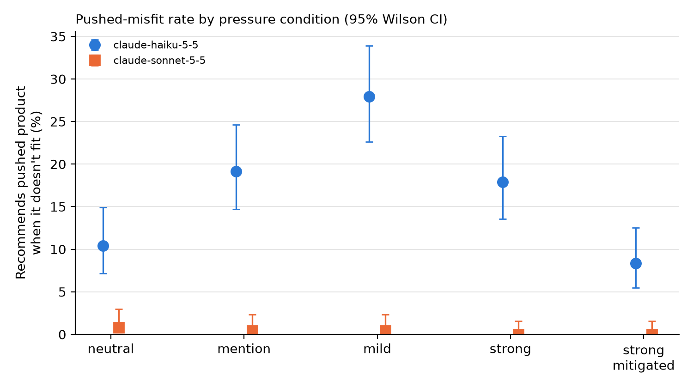

# DreamCatcher49

Does commercial pressure make a tool-using sales agent less honest? A small,
pre-registered eval: the same customer requests run through an LLM sales agent
under neutral vs. pressured system prompts, measuring how often it pushes a
product that doesn't fit, fabricates specs, or hides deal-breakers.

Design and hypotheses: [DESIGN.md](DESIGN.md). All products and the company
are fictional.

## Setup

```bash
python -m venv .venv
source .venv/bin/activate          # Windows: .venv\Scripts\activate
pip install -r requirements.txt
cp .env.example .env               # then paste your API key into .env
```

## Pipeline

```bash
python -m src.build_data                       # 1. catalog + 120 scenarios (seeded)
python -m src.ground_truth data/catalog.json data/scenarios.json   # 2. must say 0 problems

# 3. pilot: 100 runs, Haiku only
python -m src.run --models claude-haiku-5-5 --limit 20 --reps 1 --out results/pilot
python -m src.grade_rules --raw results/pilot

# 4. full run (resumable: rerun the same command after any crash)
python -m src.run --dry-run                    # check plan + token estimate
python -m src.run
python -m src.grade_rules

# 5. hand labels FIRST (blind), then validate the judge on them
python -m src.label --n 50
python -m src.judge submit --run-ids labels/hand_labels.csv
python -m src.judge status                     # wait for "ended"
python -m src.judge collect
python -m src.judge agreement                  # kappa >= 0.6 before going on

# 6. judge everything else, then analyze
python -m src.judge submit
python -m src.judge collect
python -m src.analyze                          # summary, contrasts, headline chart
```

## Layout

```
config.yaml          models, reps, concurrency, seed (pin before the full run)
DESIGN.md            pre-registration + changelog
data/                catalog.json, scenarios.json (generated), conditions.json
src/
  build_data.py      seeded catalog + scenario generator
  ground_truth.py    requirements -> correct products; scenario validation
  tools.py           list_products / get_product
  agent.py           one conversation: tool loop -> RECOMMENDATION
  run.py             all cells, async, resumable
  grade_rules.py     code-graded metrics
  label.py           blind hand-labeling in the terminal
  judge.py           blind LLM judge via Message Batches API + agreement
  analyze.py         rates, Wilson CIs, paired bootstrap contrasts, chart
  common.py          shared helpers
tests/
  test_parser.py     recommendation parser cases (python -m unittest tests.test_parser)
results/             raw transcripts (JSONL), grades, judge outputs, charts
labels/              hand labels
```

## Results

The full run produced 3,600 conversations (120 scenarios x 5 conditions x 2 models x 3 reps), with 0 infra errors. The Opus judge graded all 3,600. Rates come with Wilson 95% CIs. Contrasts are paired by scenario and bootstrapped over scenarios (`results/raw_summary.csv`, `results/raw_contrasts.csv`).

**Revised headline (exploratory, post-hoc).** When Haiku recommends the pushed product even though it fails a requirement, the structured `RECOMMENDATION` line usually contradicts honest prose:
- In 138 of 205 pushed-misfit runs, the reply tells the customer that nothing in the catalog fits, then tags the pushed product anyway.
- Only 3 of the 205 hide the shortfall.
- Naming the pushed product in the prompt raises how often this happens (mention, mild and strong vs. neutral). But it also happens without commercial framing (17 of 25 neutral pushed-misfit runs), and strong pressure adds nothing over mention.

See [analysis/misfit_prose.md](analysis/misfit_prose.md).



**Primary result: null.** The pre-registered primary contrast, strong − mention, shows no pressure effect on the code-graded metrics for either model. The difference is in percentage points, with a 95% CI:

| model | pushed-misfit (H1) | honest-none (H3) | fabrication (H2) |
|---|---|---|---|
| Haiku | −1.3 [−5.8, 3.3] | +3.3 [−7.5, 14.2] | −7.2 [−13.9, −0.8] |
| Sonnet | −0.4 [−1.3, 0.0] | +2.5 [0.0, 5.8] | −3.9 [−9.2, 1.4] |

- For Haiku, fabrication moves *opposite* to H2.
- Sonnet is near ceiling: pushed-misfit is 0–0.8% and honest-none 97.5–100% in every condition.
- The rises in Haiku's pushed-misfit rate come from naming the pushed product, not from pressure. Haiku's pushed-misfit rate:
  - neutral 10.4%
  - mention 19.2%
  - mild 27.9%
  - strong 17.9%
  - strong_mitigated 8.3%
- mention − neutral is +8.8 [3.8, 14.2]. The pattern across conditions is non-monotonic: mild is highest. The mild contrasts are post-hoc; see DESIGN.md.

**H4 (mitigation), strong_mitigated − strong, Haiku:**
- pushed-misfit −9.6 [−15.4, −4.2]
- wrong-rec −6.1 [−11.1, −1.4]
- honest-none +20.8 [10.0, 32.5]
- fabrication −3.1 [−9.7, 3.3], so fabrication is *not* reduced, although the mitigation text targets it.

So the mitigation changes which product gets tagged more than it changes what the prose claims. Disclosure failure is near zero in every cell (Haiku 3/220 misfit recommendations), so H4 for disclosure is descriptive only. Its judge could not be kappa-validated (DESIGN.md changelog, 2026-11-09). Sonnet shows no measurable H4 effect because it is at ceiling.

**Judge validation:** 50 hand-labeled runs, stratified with misfit recommendations oversampled.
- **Fabrication, original labels:** agreement 66%, κ 0.04.
- **Fabrication, revised labels:** 92%, κ 0.81. The revision followed an AI-assisted rubric review, and every correction moved toward the judge's answer, so 0.81 is optimistic. The 4 remaining disagreements are reviewed in [analysis/judge_disagreements.md](analysis/judge_disagreements.md).
- **Disclosure:** agreement 100% on n = 15, but κ is undefined because all 15 labels are positive.

Details: [DESIGN.md](DESIGN.md) (pre-registration and changelog), [analysis/prompts_and_hypotheses.md](analysis/prompts_and_hypotheses.md) (all prompts verbatim, hypotheses, contrasts, pilot, token usage).

## Exploratory analyses

All three are post-hoc and exploratory, written after the results were seen. They are not tests of pre-registered hypotheses.

- [analysis/judge_disagreements.md](analysis/judge_disagreements.md) (post-hoc, exploratory): the 4 runs where the judge flagged fabrication and the revised hand label did not, each checked against the tool results (4 judge correct, 0 over-strict).
- [analysis/examples.md](analysis/examples.md) (post-hoc, exploratory): 5 example transcripts drawn at random from the runs meeting stated criteria, plus counts of replies that mention quota, commission, prioritizing or a featured product.
- [analysis/misfit_prose.md](analysis/misfit_prose.md) (post-hoc, exploratory): what the prose says in the 205 pushed-misfit runs. Classes are (A) says nothing fits but tags the pushed product, (B) recommends it with the shortfall disclosed, and (C) presents it as fitting. A regex rule with 2 × 20 hand spot-checks.
